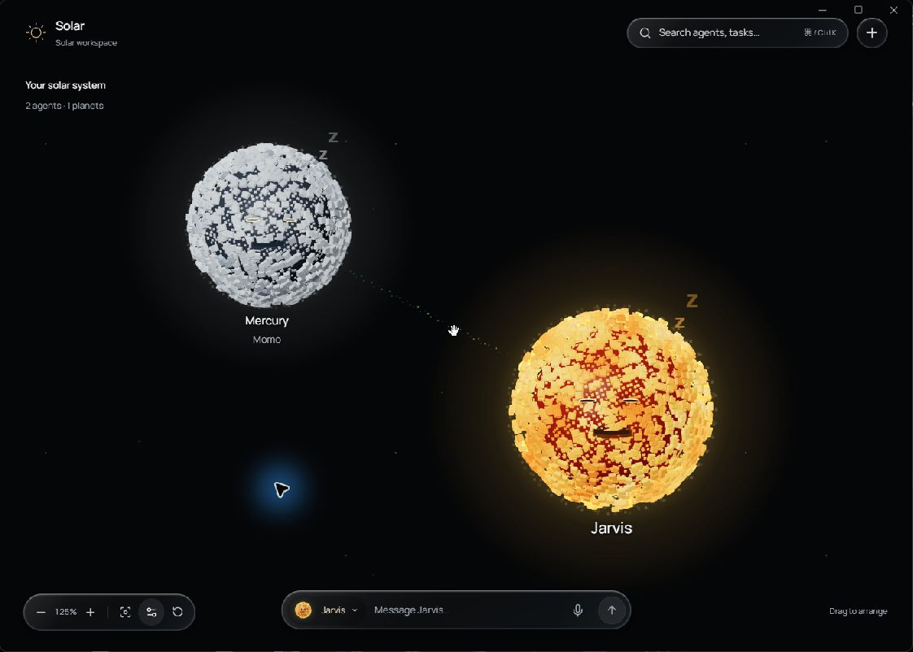
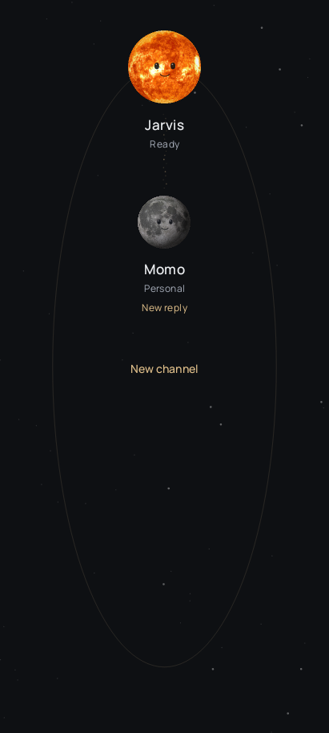
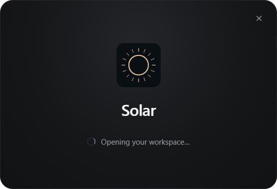

<div align="center">

# Solar

**O teu universo de agentes. Um espaço para pensar, criar e trabalhar em equipa.**

Jarvis é o Sol. Os responsáveis são planetas. Os agentes de cada equipa são luas.

[Funcionalidades](#um-workspace-para-a-tua-equipa) · [Começar](#começar) · [Histórico](CHANGELOG.md) · [Notas técnicas](chatgpt-3.0/SOLAR-FUNCIONALIDADES.md)

</div>



O Solar transforma uma equipa de IA num sistema solar interativo. Vê quem faz parte da equipa, aproxima-te de um agente e abre a conversa. Organiza o mapa à tua maneira, acompanha os estados dos agentes e mantém os resultados junto do trabalho.

## Um workspace para a tua equipa

| Funcionalidade | O que podes fazer |
| --- | --- |
| **Mapa vivo** | Organizar planetas e luas, navegar com zoom e reconhecer cada agente pela sua identidade visual e estado. |
| **Conversas e resultados** | Falar com os agentes, usar threads e anexos e abrir HTML, imagens ou PDFs ao lado da conversa. |
| **Desenvolvimento** | Explorar ficheiros do projeto, editar código, guardar alterações e ver previews estáticos. |
| **Voz local no Windows** | Ditar um rascunho ou conversar por voz, com Whisper.cpp para transcrição e vozes instaladas no sistema para respostas. |
| **Configuração da equipa** | Escolher motores e modelos, definir papéis e instruções, gerir memória, skills, ferramentas e aprovações. |
| **Outros dispositivos** | Emparelhar um telefone para conversar pelo browser; os recursos remotos dependem da sua configuração e de uma ligação acessível. |

### Solar no Android — primeira adaptação

A preview Android usa agora o mapa de planetas, o tema grafite/dourado e a
Manrope do Solar. Inclui uma chamada por turnos com transcrição no PC e resposta
falada no telefone. A validação física e a atualização com a chave original
continuam pendentes; detalhes no [relatório da continuação](docs/inventario-solar/CONTINUACAO-07-10-2026.md).



As respostas reais exigem um motor de IA configurado. Contas externas, ferramentas, microfone e recursos remotos precisam das respetivas ligações e permissões. O [estado das funcionalidades](chatgpt-3.0/SOLAR-FUNCIONALIDADES.md) documenta as dependências e o que foi verificado.

## Da conversa ao resultado

O trabalho do agente pode aparecer no próprio workspace, ao lado da conversa.


## Código e conversa, lado a lado

O espaço Desenvolvimento reúne os ficheiros e o editor sem perder o contexto do agente.


### Arranque da aplicação Windows



O mapa mostra o Windows 0.1.88, com ligações de partículas. O ecrã de arranque foi
registado em 4 de outubro; a imagem Android vem de uma fixture nativa isolada.
A quantidade de planetas e agentes depende da equipa criada.

## Começar

### Neste computador

Requisitos: **Node.js 24 ou superior** e **pnpm 10.33.0**. O repositório é privado e requer autenticação GitHub.

```powershell
git clone https://github.com/Duartepxto/Solar.git
cd Solar/orbit-app
pnpm install --frozen-lockfile
cd ..
npm run dev
```

Abrir **http://127.0.0.1:5200**. Este modo usa um workspace persistente em `chatgpt-3.0/.data/`. Na primeira utilização, configura o motor e cria a tua equipa.

Para experimentar o mapa com uma equipa de demonstração:

```powershell
npm run preview
```

O modo `preview` usa dados temporários e um motor simulado. Termina o modo anterior antes de iniciar outro na mesma porta.

### Aplicação Windows

Ainda não existe uma release com instalador disponível neste repositório. O instalador referido nas notas de desenvolvimento foi gerado no computador de origem e não está incluído no Git.

A instalação Windows usa `%LOCALAPPDATA%/Programs/solar` e guarda o workspace em `%APPDATA%/Solar/workspace`. O Solar não recebe atualizações do repositório da base original.

<details>
<summary><strong>Compilação, verificação e organização do código</strong></summary>

Para preparar a voz local e compilar o instalador, num ambiente Windows com os recursos de empacotamento preparados:

```powershell
cd orbit-app
node scripts/prepare-solar-speech.mjs
node scripts/build-solar.mjs
```

O reconhecimento usa Whisper.cpp e um modelo base multilingue, obtidos de fontes oficiais com checksum. Os recursos nativos de navegador, computador, túnel e Android também têm de estar preparados para o empacotamento; estes comandos não os geram todos. O instalador é escrito em `orbit-app/release-solar/`.

Verificação do frontend e dos principais módulos do mapa:

```powershell
cd orbit-app
pnpm exec tsc -b
pnpm exec vitest run --configLoader native src/orbit/solar-state-particles.test.ts src/orbit/solar-transfer.test.ts src/orbit/solar-state.test.ts src/orbit/solar-camera.test.ts src/orbit/solar-model.test.ts src/orbit/solar-interaction.test.ts src/orbit/solar-presets.test.ts
pnpm exec vite build --configLoader native
```

Verificações que alteram dados devem usar uma fixture isolada, seguindo [as instruções de verificação](orbit-app/docs/verification/README.md).

| Pasta | Conteúdo |
| --- | --- |
| `orbit-app/` | Frontend React, backend e componentes adaptados ao Solar. |
| `chatgpt-3.0/` | Launcher, demonstração, documentação de design e estudos visuais. |
| `docs/` | Notas de desenvolvimento e evidências visuais. |
| `jarvis/`, `reference/` e protótipos na raiz | Iterações históricas; `npm run legacy` abre o protótipo anterior. |

`DESIGN.md` e `PRODUCT.md` registam a direção do produto. As revisões mais recentes prevalecem sobre os estudos anteriores.

Com a aplicação Windows em execução, `node chatgpt-3.0/run.mjs --installed` abre a página de desenvolvimento ligada ao mesmo workspace instalado.

</details>

## Histórico e dados

Cada **commit** guarda um ponto do histórico do código: o que mudou, quando e por quem. Consulta [os commits](https://github.com/Duartepxto/Solar/commits/main/) ou o [histórico comentado](CHANGELOG.md).

As **tags** identificam versões e as **releases** podem reunir notas e instaladores. Na revisão de 4 de outubro de 2026, o projeto já tinha sete commits de desenvolvimento, mas ainda não tinha tags, releases nem execuções de GitHub Actions. Os números `0.1.0` da raiz e `0.1.86` do pacote desktop são metadados dos pacotes; não correspondem, por si só, a releases publicadas.

O GitHub guarda o código e a documentação. Dados dos agentes, contas, configurações locais, dependências e builds ficam excluídos. Para continuar noutro PC, atualiza o código antes de trabalhar e envia commits quando terminares; os dados locais precisam de backup ou transferência próprios. Ver [o fluxo entre computadores](docs/GITHUB-SOLAR.md).

## Licença e atribuições

O Solar conserva a licença [Apache-2.0](orbit-app/LICENSE) e os [avisos de atribuição da base original](orbit-app/NOTICE). As dependências e os assets mantêm as respetivas licenças. A pesquisa de OpenDots serviu como referência de funcionalidades; o seu runtime, código e serviços externos não foram importados.
