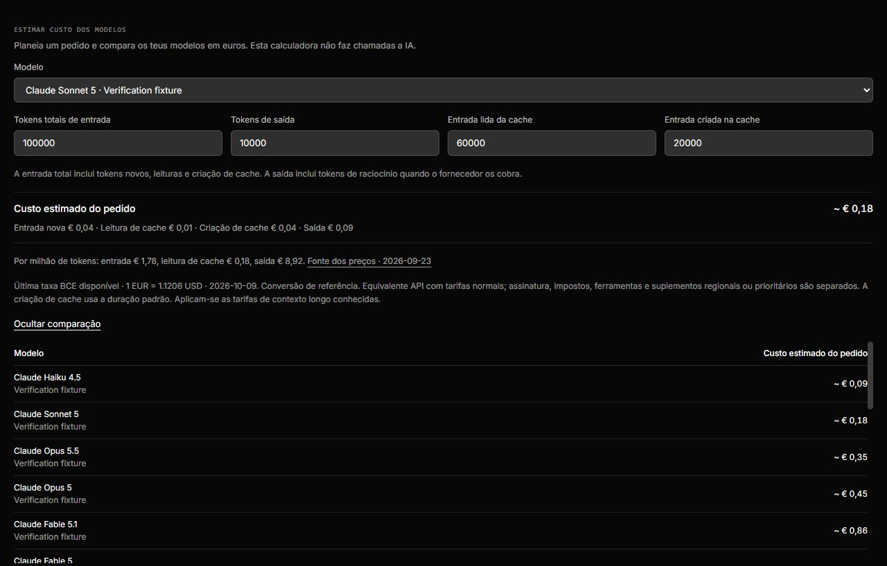
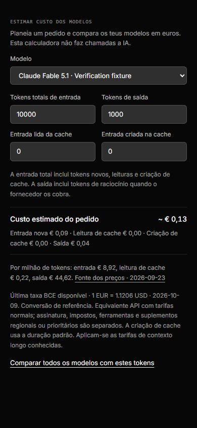

# Solar: backend, modelos e custos — 10/10/2026

## Resultado desta intervenção

Esta intervenção acrescenta uma calculadora de custos em euros à área de consumo,
atualiza a descoberta e alguns defaults de modelos e melhora a coordenação entre
agentes. Preserva as alterações que já existiam no workspace. Não certifica que
todas as funcionalidades do produto estão prontas: contas reais, dispositivos,
permissões nativas e alguns cenários da suíte ampla ainda precisam de aceitação.

### Trabalho efetivamente implementado

- **Coordenação:** a recuperação valida que cada cadeia de pedidos chega à sua
  raiz, recusando ciclos e raízes inconsistentes sem reescrever os dados
  danificados. Uma origem concluída, falhada ou cancelada não aceita novas
  atribuições. Um retry idêntico conserva o recibo original e a conversa fixada.
- **Resultados longos:** o limite de 12 000 caracteres é mantido, mas o resumo de
  transporte conserva início e fim, assinalando o trecho omitido. A conclusão e
  as ressalvas finais deixam de desaparecer por um corte exclusivamente inicial.
- **Grok:** consulta `/language-models`, descobre modelos e aliases, exclui
  geradores de imagem/vídeo, partilha um refresh concorrente e retém o último
  catálogo utilizável quando o fornecedor falha. O fallback e os helpers deixam
  de selecionar os antigos Grok 3/4 retirados. Os pedidos de stream pedem uso;
  turnos apenas de texto também guardam tokens e cache no evento final. O custo
  reportado em `cost_in_usd_ticks` é convertido, sem tratar um campo `cost`
  genérico como dólares.
- **OpenRouter:** as chamadas da mesma conversa usam uma identidade opaca e
  estável de sessão, favorecendo sticky routing mesmo quando o início do replay
  muda. O provider order explícito mantém prioridade. Outras APIs compatíveis
  não recebem este campo. O catálogo passa a aproveitar a janela de contexto e
  os preços de entrada, saída, leitura e criação de cache do fornecedor.
- **Groq:** o preset sem modelo explícito passa a GPT OSS 120B/20B. O Llama 3.3
  foi retirado do serviço normal; uma seleção explícita, incluindo contratos
  enterprise que ainda o permitam, é conservada. Os preços dos presets são os
  da Groq, não preços de outro serviço que use o mesmo slug.
- **Claude e Mistral:** acrescenta Sonnet 5.5 e Haiku 5.5 ao fallback Claude,
  mantendo a descoberta da CLI; inclui Mistral Large 4. Os aliases Mistral só
  herdam preços quando o catálogo os associa explicitamente ao modelo concreto.
- **Moeda e preços:** a calculadora usa euros e mostra fonte/data dos preços e
  data da taxa BCE. O ledger mantém a unidade original USD; valores históricos
  não são relabelados. Os preços EUR de configurações antigas são normalizados
  antes da contabilização. Preços descobertos também servem de estimativa para
  novos modelos, respeitando overrides exatos e custos reportados. Corrige a
  leitura de cache do Sonnet 5.5 para a tarifa publicada de $0.10 por milhão.
- **Calculadora:** divide entrada em tokens novos, leitura e criação de cache,
  soma saída uma vez, aplica os escalões longos conhecidos e exclui cenários
  maiores que a janela conhecida. Compara todos os modelos do catálogo com o
  mesmo cenário. Alterar os números não envia prompts nem pede trabalho a IA.
  Preços desconhecidos permanecem desconhecidos.
- **Transporte fleet:** reutiliza o leitor JSON limitado e incremental. Mantém
  caracteres UTF-8 partidos entre chunks e limita bytes, sem continuar a reter
  um corpo excessivo após devolver 413.
- **Verificação Windows:** o teardown regista a confirmação do encerramento da
  árvore própria. Não confunde o exit code 1 de `taskkill` com um crash do produto
  nem aceita processos já falhados. Fixtures de Stop aguardam uma origem realmente
  em espera, e expectativas de cache/renomeação refletem os contratos atuais.

## Como o backend está organizado

O runtime tem 18 drivers registados, combinando CLIs com sessão, ACP, APIs de
chat compatíveis e execução remota. As funcionalidades principais incluem
conversas independentes e ramos, canais, delegação, objetivos e rotinas, memória,
MCP e ferramentas, aprovações, ficheiros/anexos, computadores/navegador, voz,
emparelhamento, autenticação, uso/orçamentos, backups e operação fleet/cloud.

A sessão nativa usa recibos de contexto e alterações incrementais. Instruções
estáveis e contexto volátil são separados para evitar reconstruções por uma
simples mudança de memória ou menção. Os providers stateless reconstroem a
entrada selecionada; caching reduz o preço de partes reutilizadas, mas não
elimina esses tokens. Os resultados de colegas continuam dados de colegas,
sem adquirir autoridade de instrução humana.

Os limites de profundidade, pedidos e execuções dos handoffs já existiam. Foram
preservados: reduzir indiscriminadamente contexto ou paralelismo para parecer
mais barato pode perder trabalho e baixar produtividade. A poupança introduzida
é estrutural — melhor reutilização de sessão/cache e modelos funcionais — e não
uma percentagem inventada de redução de custos.

## Evidência

- Uma conversa pela superfície oficial `control-orbit`, em perfil temporário,
  preservou `Olá, ação ☀️ 🪐 日本語`, recebeu a resposta fake e terminou `settled`.
- A nova API de preços devolveu EUR, fontes e a referência BCE de 09/10/2026:
  **1 EUR = 1.1206 USD**. Não houve chamada a um modelo para obter preços.
- A calculadora real foi observada e operada no browser, em desktop e a 390 px.
  Para Sonnet 5, 100 000 input / 10 000 output / 60 000 cache lida / 20 000 cache
  criada deram aproximadamente **€0.18**. É uma simulação API, não uma fatura.
- Tipos frontend e servidor passaram. O build Vite de produção passou; continua
  a sinalizar chunks grandes já pertencentes ao conjunto da aplicação.
- Catálogos de tradução válidos, com as novas mensagens em inglês e português.
- Execuções focadas passaram: 349 testes de contexto/consumo; 161 de providers e
  ferramentas; 101 de preços/catálogos; 156 do conjunto de alterações; 148 de
  handoffs, delegações e matemática. Estes grupos sobrepõem-se, não se somam.
- Reproduções de quatro fluxos API passaram após o ajuste comprovado do teardown
  Windows. As verificações selecionadas de identidade de equipa e ledger passaram.
- A execução final dos preços, catálogos, Grok, handoffs e cleanup passou: 126
  testes em oito ficheiros. Cinco fluxos HTTP/MCP de comunicação também passaram:
  modelo atual do destinatário, steering com colega ativo, fila opt-in, paging
  completo do roster e recuperação após rejeição de sessão. Os testes usam gates
  explícitos em vez de assumir que um delay de quatro segundos preserva o estado.
- O paging segue o offset anunciado pelo resultado, sem saltar do preview de
  4 000 para 16 000 caracteres e perder o trecho intermédio. Esta era uma
  expectativa antiga da fixture; o transporte do produto já anunciava o offset.
- Os builds finais de frontend e backend passaram. Os grupos focados acima
  sobrepõem-se e não constituem uma nova execução integral de toda a suíte.
- Os cinco cenários HTTP de contas Claude passaram após aplicar o mesmo recibo
  de encerramento Windows ao teardown. Tipos finais frontend/servidor, lint dos
  módulos alterados e validação dos dez catálogos de tradução passaram.

Capturas da fixture:

O guia reproduzível é
[model-costs.md](../../orbit-app/docs/verification/model-costs.md).

## Limites e continuidade

1. A suíte ampla inicial terminou com 6 213 testes aprovados, 23 falhados,
   185 ignorados e um todo. Começou antes das alterações e continuou enquanto
   os ficheiros eram corrigidos, pelo que mistura módulos antigos e fixtures
   novas e não é um retrato consistente da versão final. Seis falhas de links
   simbólicos são EPERM do Windows ao criar a fixture, antes de verificar a
   proteção. As falhas de comunicação, paging, pricing e teardown foram
   reproduzidas em grupos focados após as correções. Isso não demonstra ausência
   de interferência numa execução integral sob carga. O log original fica em
   `orbit-app/backend-audit-verified.log`; evidência final em
   `backend-final-focused.log` e `backend-final-coordination.log`.
2. Não foram enviados prompts a fornecedores reais nem alterado o workspace
   pessoal. Uma conta/CLI/API deve confirmar modelo, ferramentas, auth, limites,
   reconexão e custos reais antes de se declarar essa integração aceite.
3. A calculadora mostra equivalentes API Standard: impostos, assinatura, tools,
   prioridades, regiões, cache storage, duração alternativa de cache e preços
   privados têm regras próprias. A tabela não avalia qualidade ou diferenças de
   tokenização. Alguns modelos têm apenas uma tarifa base publicada nesta tabela;
   só os escalões longos conhecidos são calculados.
4. Preço de catálogo não confirma acesso da conta. Nem todo modelo disponível
   numa API suporta todas as ferramentas. Preferir discovery/capabilities a
   novos slugs fixos; conservar seleções explícitas e explicar incompatibilidades.
5. Para reduzir custo real no dia a dia, medir por tarefa concluída: incluir o
   coordenador, colegas, retries, helpers e ferramentas. Priorizar instruções
   estáveis, briefs focados, resultados úteis e execução direta quando delegar
   não acrescenta qualidade. Não trocar automaticamente todos os modelos por
   um barato nem reduzir effort sem distinguir a exigência da tarefa.
6. `server/index.ts` continua grande. A nova API está num módulo de rotas com
   dependências explícitas. A decomposição deve avançar por fronteiras como
   accounting, coordenação e sessões, preservando os seus contratos; não há
   benefício comprovado numa reescrita global só para reorganizar o código.

## Fontes oficiais consultadas

- [OpenAI: modelos e preços](https://developers.openai.com/api/docs/pricing)
- [OpenAI: catálogo por conta](https://developers.openai.com/siwc/token-sharing-open-source/models-and-inference)
- [Claude: tarifas de tokens e cache](https://platform.claude.com/docs/en/about-claude/pricing)
- [xAI: modelos e pricing](https://docs.x.ai/developers/rest-api-reference/inference/models)
- [xAI: custo reportado e stream](https://docs.x.ai/developers/cost-tracking)
- [OpenRouter: catálogo](https://openrouter.ai/docs/api/api-reference/models/list-all-models-and-their-properties)
- [OpenRouter: caching e sessões](https://openrouter.ai/docs/guides/best-practices/prompt-caching)
- [Groq: modelos](https://console.groq.com/docs/models)
- [Groq: modelos retirados](https://console.groq.com/docs/deprecations)
- [Mistral Large 4](https://docs.mistral.ai/models/mistral-large-4-0)
- [Gemini: preços](https://ai.google.dev/gemini-api/docs/pricing)
- [MiniMax: preços](https://platform.minimax.io/docs/guides/pricing-paygo)
- [BCE: referência de câmbio](https://www.ecb.europa.eu/stats/policy_and_exchange_rates/euro_reference_exchange_rates/html/index.fr.html)

A pesquisa 21st foi tentada, mas o CLI não tinha sessão autenticada. A interface
reutiliza os componentes e tokens existentes do Solar, sem gerar UI paga nem
publicar código. O detector visual determinístico não encontrou problemas no
componente.
