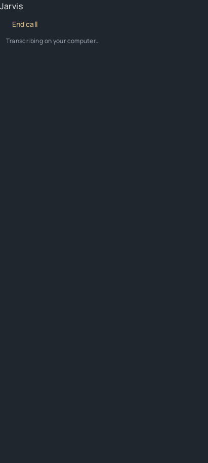

# Continuação do Solar — 7 de outubro de 2026

## Resultado local

- Solar Windows **0.1.88** instalado e aberto. O `app.asar` instalado corresponde
  ao instalador compilado. Health 200 e Whisper local pronto.
- As ligações do mapa principal são partículas, com cores do emissor e do
  destinatário. Os pacotes de comunicação, receção, resultados e relays usam o
  renderer anterior, preservado. Movimento reduzido e pausa continuam respeitados.
- Android **1.0.1-solar-preview** preparado em
  `orbit-app/release-solar/android/Solar-Android-preview.apk`.
- Primeira adaptação visual Android: mapa vertical de planetas, Jarvis como sol,
  fundo grafite, controlos dourados, Manrope local e avatares consistentes nas
  conversas e seletores. O assistente interno continua visível como sol mesmo
  quando o protocolo o oculta das listas comuns.
- Pesquisa, gestão de threads, canais e aprovações mantidas. Abrir novamente
  um agente restaura a thread escolhida no telefone, sem mudar a seleção do PC.
- Chamada em primeiro plano: PCM mono 16 kHz, máximo de 29 segundos, envio após
  pausa ou botão, Whisper no PC e TTS no telefone. Silêncio não vira comando.
  Sair, passar para segundo plano ou perder/mudar a ligação termina a chamada.
  Não há reenvio automático de ações nem áudio simultâneo/interrupção pela voz.
- O sidecar autoriza apenas status e transcrição, para dispositivos emparelhados.
  O parser valida formato, tamanhos e alinhamento PCM; a transcrição tem prazo
  máximo e é cancelada ao fechar a resposta HTTP.

## Acesso fora de casa

O Tailscale deste PC já estava ligado. O companion foi ativado nas preferências
existentes e respondeu 200 tanto por loopback como pelo endereço privado Tailscale.
Pedidos a `/api/bots` sem token deram 401 em ambos. Não foi criada exposição
pública, configuração de router ou conta externa.

O companion deste PC ainda não tem dispositivos emparelhados. No Android, usar
a mesma rede Tailscale e emparelhar este PC nas definições do Solar. A verificação
por 4G/Wi-Fi a partir do telefone ainda falta; uma sonda local ao endereço
Tailscale não a substitui. O PC precisa de estar ligado, acordado e com o Solar aberto.

## Assinatura Android

Os dois APK passaram a verificação de assinatura v2, mas os certificados são
diferentes: a preview antiga foi assinada no outro PC. O utilizador respondeu
que não tem acesso à chave agora e pediu para deixar o APK preparado.

Recuperar o `debug.keystore` original, manter fora do Git e usar:

```powershell
./orbit-app/scripts/build-solar-android.ps1 -SigningKeyPath C:/caminho/debug.keystore
```

Depois confirmar que o certificado corresponde à primeira preview e instalar
com atualização (`adb install -r`). Não desinstalar para contornar a assinatura;
isso apagaria a confiança e os dados da app. Nenhuma app do telefone foi alterada
nesta continuação.

## Verificações

- Android: 1587 testes passaram, sem falhas; build preview, assinatura v2 e
  fixture visual nativa verificadas.
- A auditoria desktop completa foi interrompida a pedido do utilizador para
  deixar a aplicação disponível para testes manuais; não há um resultado global.
- Companion, OAuth e áudio: 153 testes passaram no conjunto principal.
- Encerramento Windows, OAuth e proxy real: 31 testes passaram; inclui um teste
  com um motor filho real que termina com a fixture.
- Electron: 455 testes passaram, 19 ignorados por plataforma/ambiente, sem falhas.
- Ligações e comunicação Solar: 20 testes passaram; incluem resultados, pausa,
  chegada e encaminhamento lua → planeta → Jarvis.
- Fixture do mapa no Chrome: passou, com movimento de partículas e renderer 3D
  ativo; perfil e servidor descartáveis. Captura do mapa Windows instalado e
  capturas nativas Android verificadas em duas passagens limitadas.
- TypeScript e build Windows passaram. Lint do código alterado passou.

Os conjuntos sobrepõem casos e não devem ser somados como total único. As
fixtures são isoladas e os cenários de voz usam substitutos do modelo/microfone.
Não se fizeram pedidos pagos ao modelo nem testes automáticos nas conversas pessoais.

## Ainda por fazer

### Partículas de pedidos entre agentes (Solar 0.1.90)

A consulta antiga ao mapa de equipa não incluía a coordenação atual entre
agentes e podia perder tarefas concluídas entre consultas de quatro segundos.
O servidor passa a emitir `agent.transfer` no envio real e na resposta bem
sucedida. O cliente liga esses eventos diretamente ao renderer de partículas
existente, com as cores, direção, chegada e relays originais. Eventos históricos
e duplicados de reconexão não repetem a animação; falhas não fingem uma resposta.
Os eventos só chegam a membros autorizados a ver os dois agentes.
Verificação: 25 testes de eventos, visibilidade e rotas passaram; o servidor
isolado confirmou envio e resposta em direto, e a fixture Chrome confirmou
mudança no canvas de comunicação nos dois sentidos (2 testes adicionais).

### Correção do teste entre agentes (Solar 0.1.89)

O pedido Jarvis → Momo falhou porque a conversa pessoal usava Codex, mas a
conversa entre agentes foi criada com o antigo modelo Claude do perfil. O
Claude local 2.1.168 rejeitou `--autocompact` antes de responder e não tinha
sessão iniciada. Nenhuma definição pessoal foi alterada para contornar isso.

`resolvePairConversation` passa a copiar o modelo e esforço da conversa atual
do destinatário para pedidos novos, conversas reutilizadas inativas e trabalho
paralelo. Mantém identidade, histórico e permissões e não muda uma conversa em
execução. Regressão: 128 testes de persistência passaram (1 ignorado), e 2
testes de comunicação em servidor isolado passaram. Estes testes usam motores
simulados; o teste pessoal será repetido pelo utilizador.

1. Com o telefone disponível: emparelhar este PC, testar mensagem/resposta,
   queda e reconexão Wi-Fi/4G, revogação e uma ação reversível no PC.
2. Testar microfone e síntese reais no PC e no telefone. O utilizador adiou ambos.
3. Recuperar a chave original e instalar o novo APK por cima do anterior.
4. Continuar a adaptação dos painéis secundários Android ao Solar. Esta etapa
   entrega mapa, identidades, tipografia, tema e controlos de chamada; não declara
   toda a interface nativa uma reprodução do renderer 3D desktop.
5. Publicar o código após confirmação. Não publicar o APK como atualização
   compatível enquanto a chave original não tiver sido usada.

## Evidência

Mapa principal instalado:


Mapa Android em Activity isolada:


Controlos de chamada em fixture de componente (não é a conversa completa):


