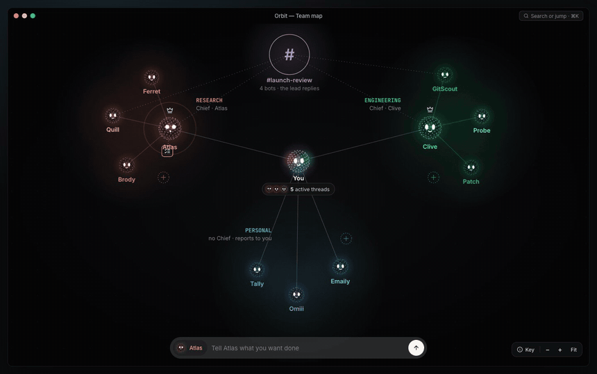
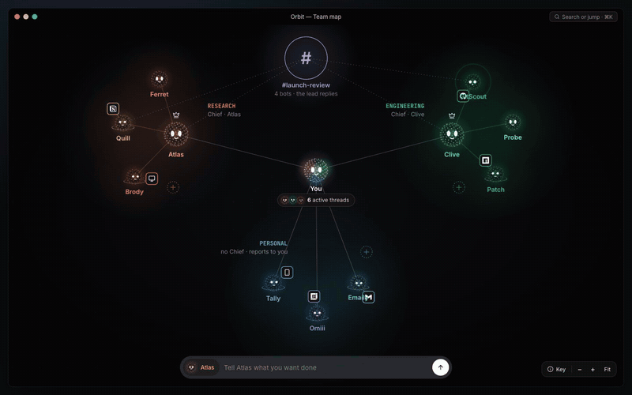
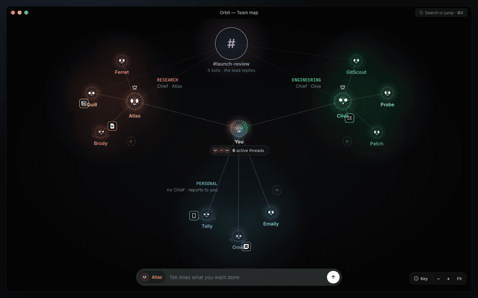
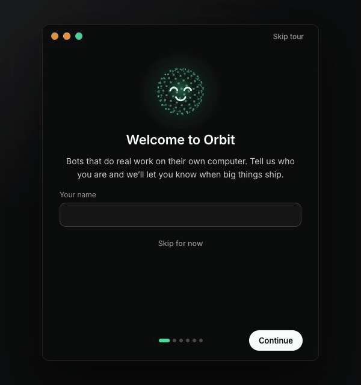
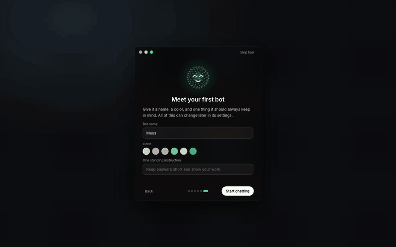

<div align="center">

# Orbit

**Your own team of AI bots, on a canvas.**

Every bot is a real agent: Claude Code, Codex or another CLI you already use,
running on your computer with its own instructions, model, computer and apps.
They live on a map around you, grouped into teams. Click one to talk to it,
watch it work, and approve what matters.



<sub>The Orbit prototype. The app follows it closely; every value shown is sample data.</sub>

</div>

---

## What it is

### A map of your team, alive

You sit at the centre; teams gather around you, each with a Chief of Staff
and its members. Each bot is a particle character in its own colour, and its
face shows what it is doing: thinking, running a tool, waiting on you,
stalled, done. Particles fly along the lines when work is handed off.



### Everything opens where you are

Click a bot and the camera flies to it: its settings (engine, computer,
browser, voice, memory, skills, routines, approvals) orbit it, and its chat
sits beside it. Nothing opens over the canvas; Esc or a click on the map takes
you back. Teams, channels and You open the same way.

### Bots show you their work

A bot that made something says so: "Atlas wants to show you
market-map.html". **View** puts it on the canvas next to the bot, a page, a
PDF, an image, or its live computer screen, which you can take over, with a
reply box that goes straight to it.



### A welcome that sets you up

The first launch is a small welcome window: your name, what your bots can do,
the engines Orbit found on your computer, permissions, your phone, and your
first bot. Then the window opens into the map, and a short tour points at the
controls you will use first.

<p>

&nbsp;

</p>

### And more

- **Teams that coordinate.** A Chief routes a request to the right teammate,
  and can change a teammate's access mid-thread. Channels hold group
  conversations with a reply rule.
- **Calls.** Talk to a bot out loud; the bot on the canvas does the talking,
  its mouth moving with its voice.
- **A calendar on the canvas** for routines: scheduled work each bot runs on
  its own.

## Engines

Orbit runs the agent CLIs you already have, each signed in with your own
account: **Claude Code**, **Codex**, **OpenCode**, **pi**, **Cursor**,
**Qwen**, **Hermes**, **Grok**, and any ACP agent or OpenAI-compatible
endpoint you add yourself ([custom engines](docs/custom-engines.md)). Each bot
picks its engine, model and effort. Codex runs from Orbit's own Codex home, so
your personal Codex servers and skills stay yours.

Connected apps are MCP servers ([custom MCP servers](docs/custom-mcp-servers.md)).
Orbit has no hosted services: no account, no broker, no analytics.

## Get started

Requirements: macOS, Windows or Ubuntu 24.04 x64, **Node 24+**, **pnpm**, and
at least one agent CLI installed and signed in.

**Run from source:**

```sh
git clone https://github.com/DragonQLF/orbit && cd orbit
pnpm install

pnpm dev:server    # the harness server → 127.0.0.1:8799
pnpm dev           # the app → http://127.0.0.1:5199
pnpm dev:desktop   # optional: the desktop window instead of a browser tab
```

**Build the Mac app for this computer:**

```sh
pnpm package:mac:local   # → release/mac-arm64/Orbit.app (or release/mac/ on Intel)
```

Move `Orbit.app` to Applications. The first launch opens the welcome flow and
creates your data folder at `~/.orbit`.

### Updates

Orbit updates from its own source. The app knows the commit it was built from;
every hour, or from ⌘K › Check for updates, it fetches your checkout. When
`origin/main` has moved on, "Orbit update" appears at the top: **Build update**
pulls the new code and rebuilds the app on your computer, and **Restart to
update** swaps it in.

## The team that maintains Orbit

Team library › **Orbit maintainers** creates three bots that work on Orbit
itself, in your checkout:

- **Pilot**, the Chief, takes your requests and hands each one to the right
  bot. It never reads the code.
- **Upstream** watches [OpenMausBot](https://github.com/milind-soni/OpenMausBot),
  the project Orbit was forked from, summarises what is new each weekday, and
  ports what you choose.
- **Builder** makes the changes you ask for.

They work in their own git worktrees, run the checks, and push to `main` only
after a yes, from you or passed on by Pilot. What they push reaches every
Orbit as an update.

## How it works

Two processes. The app sends typed commands over HTTP and folds one event
stream into its state; the harness server owns every agent process and turns
each provider's protocol into one event stream.

| Layer | Where | What it does |
|---|---|---|
| Canvas | `src/orbit/` | The map, the characters, the camera, the columns and the stage. |
| App | `src/` | Screens, the server-backed store, one reducer, no transports of its own. |
| API | `server/index.ts` | Bots, turns, approvals, models, computers, connectors, config: HTTP and SSE. |
| Drivers | `server/drivers/` | One per engine. An engine that is missing shows as unavailable; it never takes the others down. |
| Voice | `server/tts/` | ElevenLabs, Fish Audio, xAI, built-in Mac voices or a local Chatterbox. |
| Desktop | `electron/` | The macOS, Windows and Ubuntu shells, with the harness embedded. |

Orbit also ships an MCP server so other clients (Claude Desktop, Cursor) can
drive a bounded part of it: see [the MCP server](docs/mcp-server.md).

## Contributing

Read [`PRODUCT.md`](PRODUCT.md) first. It holds the rules Orbit's interface
follows, from "nothing opens over the canvas" to "every string goes through
`t()`". [`AGENTS.md`](AGENTS.md) is the short version for coding agents, and
[`docs/verification/`](docs/verification/README.md) is how a change is checked
in an isolated instance before anyone calls it done. The design handoff and
the prototype are in [`docs/design/orbit/`](docs/design/orbit/README.md).

## License

[Apache License 2.0](LICENSE) © 2026 Milind Soni and Orbit contributors,
except `enterprise/`, which is source-available under its
[own license](enterprise/LICENSE); delete that folder and what remains is the
open-source edition. Details, including how contributions are signed off, are
in [LICENSING.md](LICENSING.md).

Orbit is built on [OpenMausBot](https://github.com/milind-soni/OpenMausBot) by
Milind Soni and its contributors. Packaged Cua Driver components keep their
own licences; their notices are in [`third_party/cua-driver/`](third_party/cua-driver/).
